# System Flows — Digital Identity Wallet

Mermaid diagrams for every major user/admin action and the side effects that follow (API → database → RabbitMQ → blockchain / IPFS).

Related docs: [overview.md](./overview.md) · [architecture-and-implementation.md](./architecture-and-implementation.md) · [did-and-credential-fields.md](./did-and-credential-fields.md)

---

## Legend

| Symbol / color idea | Meaning |
|---------------------|---------|
| **Actor** | Human or portal (Admin, Holder, Verifier, Super Admin) |
| **API** | FastAPI endpoint |
| **DB** | PostgreSQL write/read |
| **Bus** | RabbitMQ event publish/consume |
| **Chain** | Hyperledger Besu contract call |
| **IPFS** | Pinata pin |

Feature flags (`.env`) can skip some chain steps: `REQUIRE_DID_ON_CHAIN`, `REQUIRE_CREDENTIAL_ON_CHAIN`, `REQUIRE_CERTIFICATE_SBT`, `REQUIRE_TRUSTED_ISSUER`, `CHECK_*_VERIFY`.

---

## 0. High-level architecture

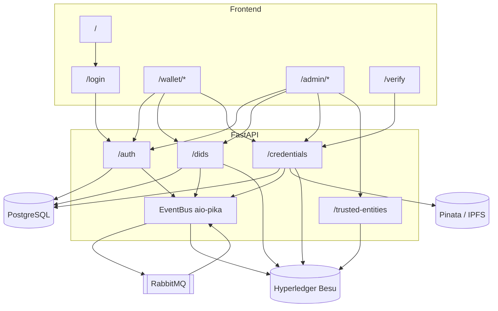

---

## 1. Frontend routing by role

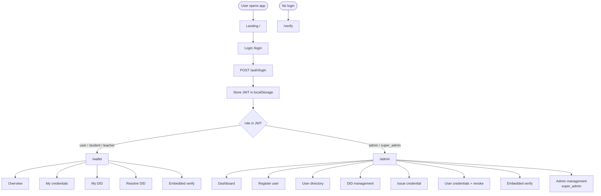

---

## 2. Login

**Action:** User submits username/password on `/login`.

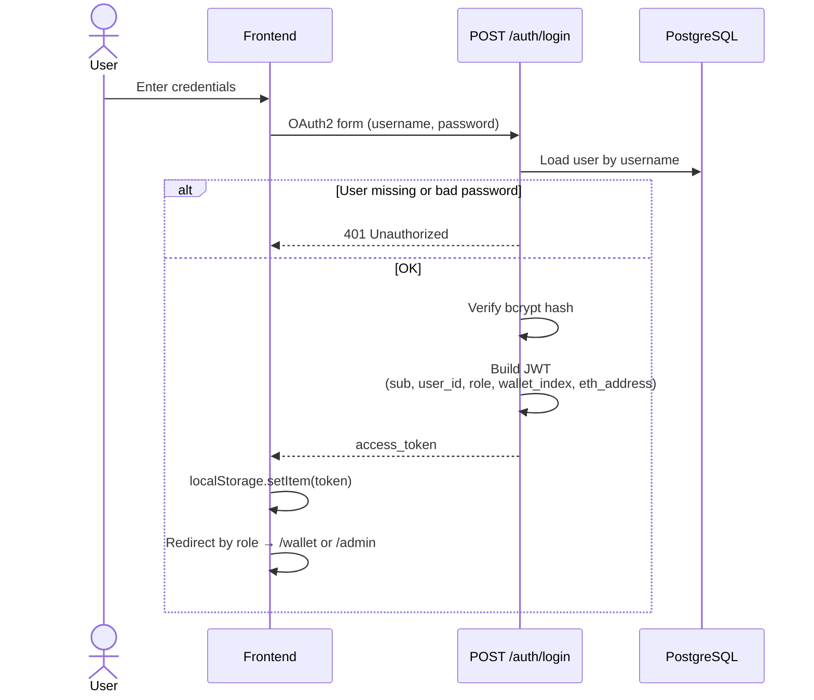

**Side effects:** None on chain. No RabbitMQ event.

---

## 3. Register user → auto DID → on-chain DID

**Action:** Admin registers a user (`POST /auth/register`).

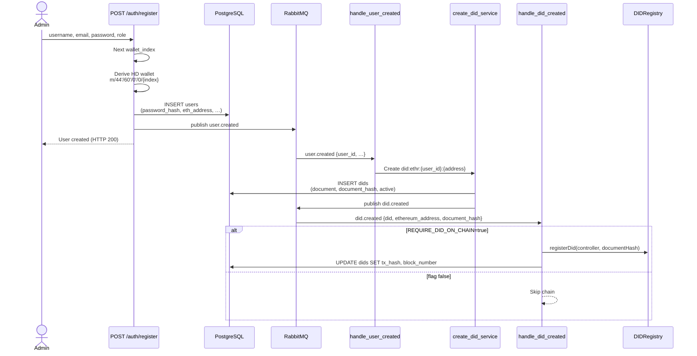

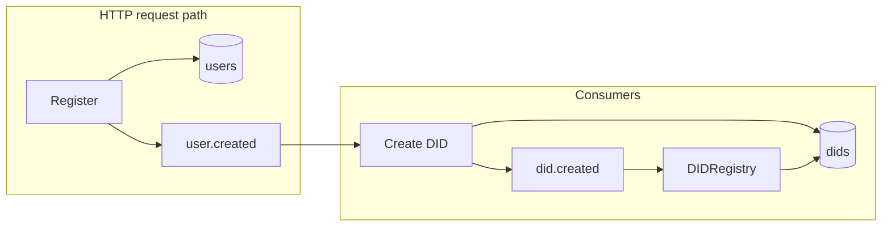

**If chain fails / delayed:** User + DID exist in DB; `tx_hash` null → UI shows DID **pending / not anchored**. Login still works.

---

## 4. Event bus map (all domain events)

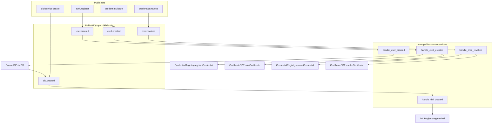

---

## 5. Issue credential (+ IPFS + registry + SBT)

**Action:** Admin issues a VC (`POST /credentials/issue`, multipart JSON + optional file).

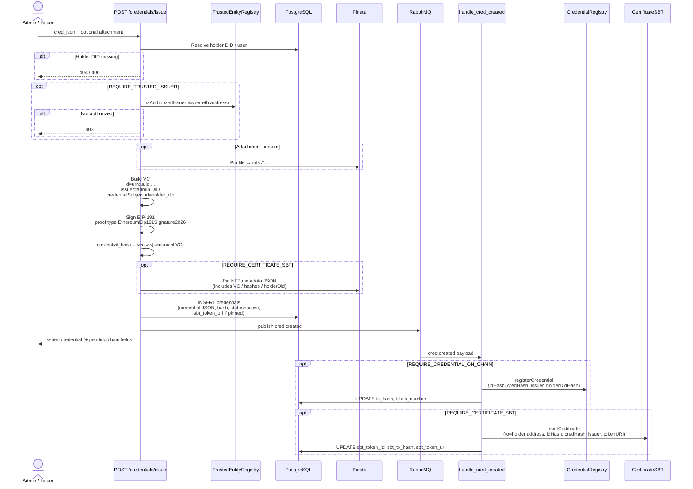

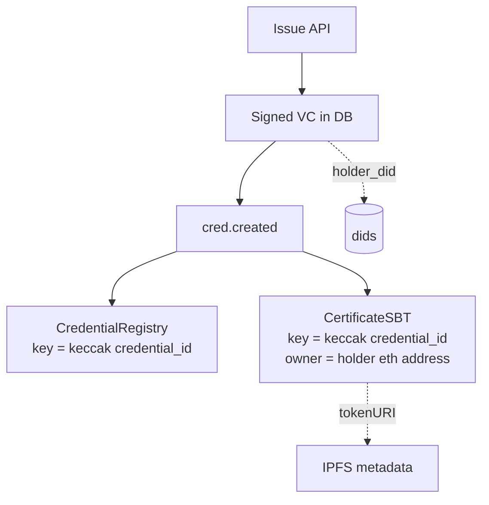

**UI after issue:** Credential visible to holder; Registry/SBT pills may show **pending** until consumers finish.

---

## 6. Verify credential (Relying Party)

**Action:** Anyone posts VC JSON to `POST /credentials/verify` (public `/verify` or embedded).

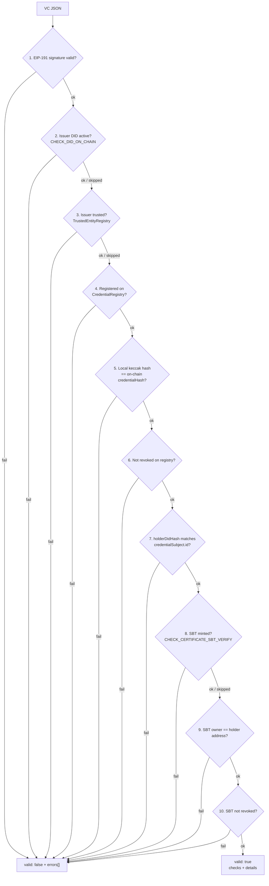

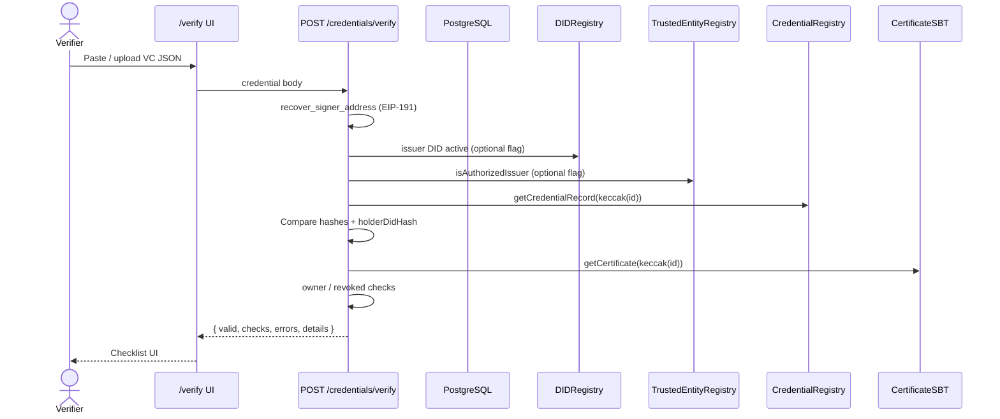

**Note:** `GET /credentials/{id}` only reads DB — it does **not** run this checklist. Trust comes from Verify (and optional on-chain status endpoints).

---

## 7. Revoke credential

**Action:** Admin revokes (`POST /credentials/revoke`).

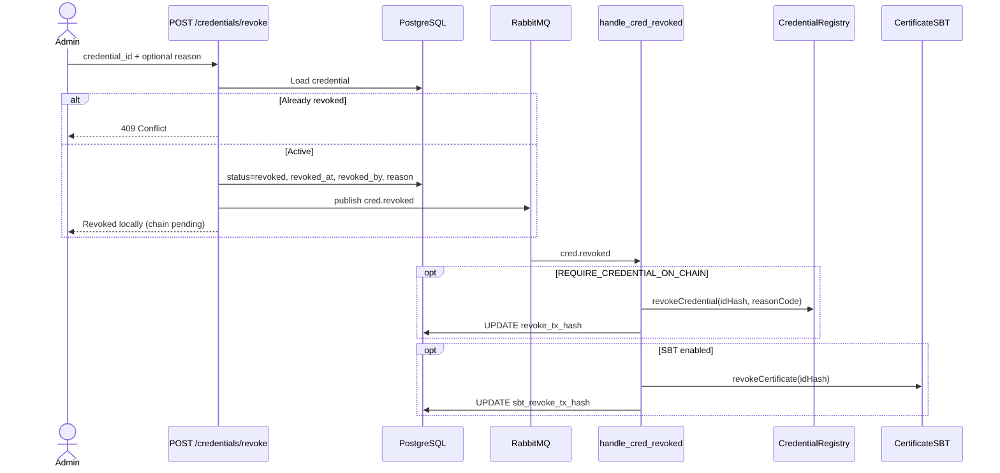

**After revoke:** Holder still sees the record as revoked; Verify fails on `not_revoked` / `sbt_not_revoked`.

---

## 8. DID resolve (public / me)

**Action:** `GET /dids/{did}` or `GET /dids/me`.

```mermaid
sequenceDiagram
  actor U as Anyone / Holder
  participant API as GET /dids/{did} or /me
  participant DB as PostgreSQL
  participant Chain as DIDRegistry

  U->>API: did string (or JWT for /me)
  API->>DB: Load dids row + document
  alt Not found
    API-->>U: 404
  else Found
    opt CHECK_DID_ON_CHAIN_RESOLVE
      API->>Chain: getDidRecord / isActive
      API->>API: Compare document_hash;<br/>set deactivated metadata
    end
    API-->>U: DID Resolution<br/>(document + metadata)
  end
```

---

## 9. Deactivate DID (admin)

**Action:** `POST /dids/on-chain/deactivate` (admin).

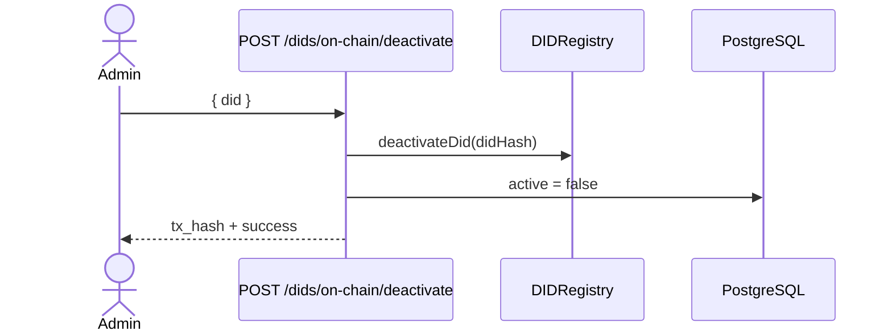

**Effect on Verify:** Issuer (or relevant) DID active check can fail → credentials from that issuer may no longer verify when DID checks are enabled.

---

## 10. Trust management (super_admin)

**Actions:** Authorize / revoke issuer; public status query.

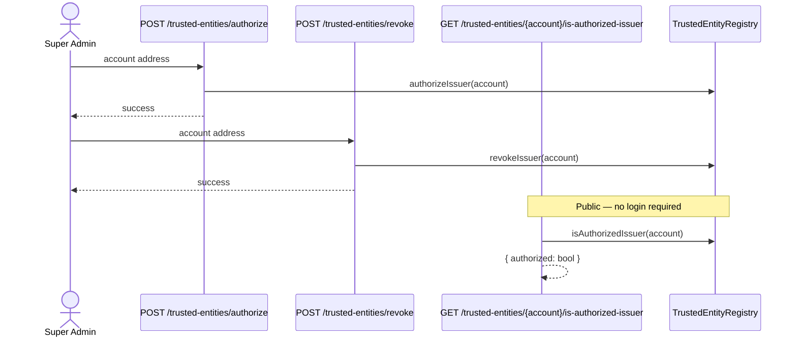

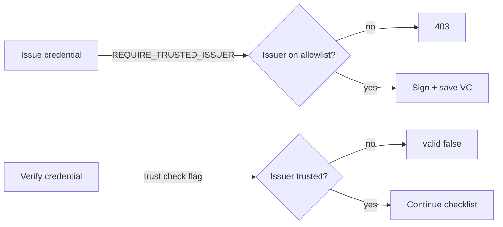

UI: primarily **Admin → Admin Management** (and Swagger). Dedicated `/admin/trust` route is currently commented out.

---

## 11. List / read credentials (no chain mutation)

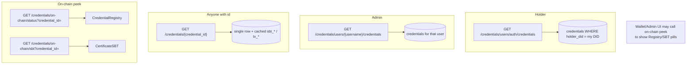

---

## 12. Linking model: DID ↔ Credential ↔ SBT

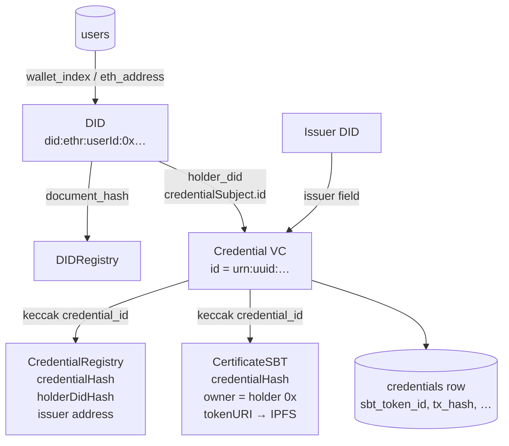

**Important:** Contracts store **`credentialIdHash`**, not the raw `urn:uuid:…` string. The verifier must possess the full VC (or at least `id`) to recompute the key.

---

## 13. DB present, chain missing (consistency)

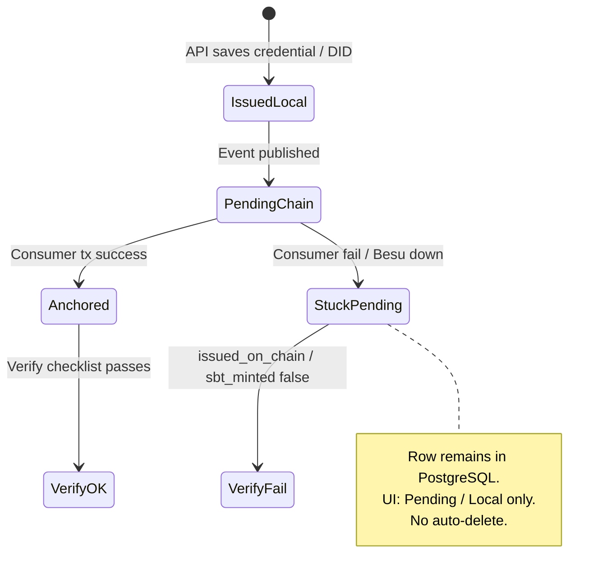

| Situation | Wallet / Admin UI | Verify |
|-----------|-------------------|--------|
| In DB, no `tx_hash` | Registry pending | `issued_on_chain: false` → invalid |
| In DB, no `sbt_token_id` | SBT pending | `sbt_minted: false` → invalid (if flag on) |
| Revoked in DB, chain revoke pending | Confirming revoke | May still fail once chain catches up; local status already revoked |

---

## 14. Bootstrap: `scripts/seed_admin.py`

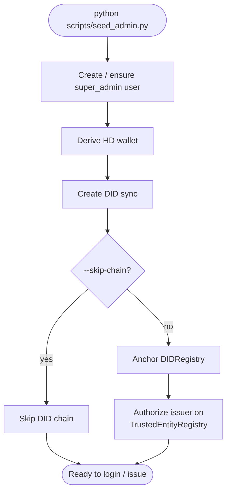

---

## 15. Admin & wallet read-only dashboards

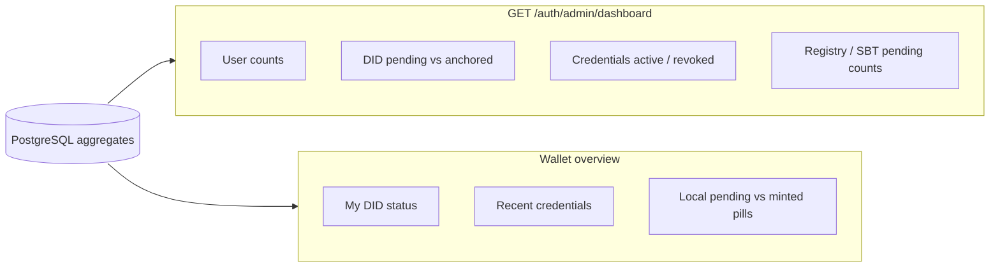

These endpoints **aggregate DB state**; they do not themselves write to Besu.

---

## 16. Auth helpers (who can call what)

```mermaid
flowchart TD
  Req[Request + Bearer JWT] --> Parse[get_current_user_from_token]
  Parse --> Role{Role check}

  Role -->|any authenticated| Me[e.g. GET /dids/me<br/>GET own credentials]
  Role -->|admin or super_admin| AdminOps[register, issue, revoke,<br/>deactivate DID, list users]
  Role -->|super_admin only| SuperOps[list/delete admins<br/>authorize/revoke issuer]
  Role -->|no token| Public[login, landing,<br/>GET /dids/id, POST /verify,<br/>is-authorized-issuer]
```

---

## Quick action → side-effect cheat sheet

| Action | HTTP | DB | Event | Chain / IPFS |
|--------|------|----|-------|--------------|
| Login | `POST /auth/login` | read user | — | — |
| Register user | `POST /auth/register` | insert user | `user.created` → DID → `did.created` | `DIDRegistry` |
| Create DID (manual) | `POST /dids/` | insert did | `did.created` | `DIDRegistry` |
| Resolve DID | `GET /dids/{did}` / `/me` | read | — | optional read registry |
| Deactivate DID | `POST /dids/on-chain/deactivate` | `active=false` | — | `deactivateDid` (sync) |
| Issue credential | `POST /credentials/issue` | insert VC | `cred.created` | IPFS + Registry + SBT |
| Verify | `POST /credentials/verify` | optional DID lookup | — | read Trust / DID / Registry / SBT |
| Revoke credential | `POST /credentials/revoke` | status revoked | `cred.revoked` | Registry + SBT revoke |
| Authorize issuer | `POST /trusted-entities/authorize` | — | — | Trust registry write |
| Revoke issuer | `POST /trusted-entities/revoke` | — | — | Trust registry write |
| Issuer status | `GET …/is-authorized-issuer` | — | — | Trust registry read |
| Get credential | `GET /credentials/{id}` | read | — | — |
| On-chain status | `GET …/on-chain/status` / `sbt` | — | — | Registry / SBT read |

---

## Contract write ownership

All registry/SBT **writes** are performed by the backend using `BESU_TRUST_ADMIN_PRIVATE_KEY` (contract `owner`), not by the end-user wallet directly. User wallets are used for **VC signing** (issuer key from HD mnemonic) and as **SBT recipients** (holder address).
